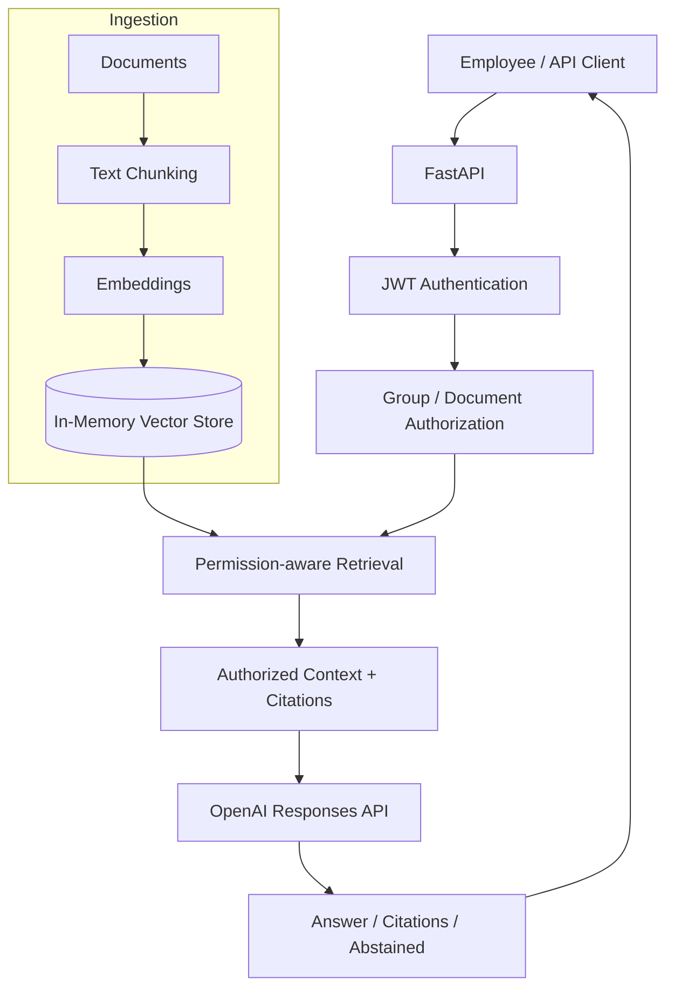

# Secure Enterprise AI Assistant

**A security-conscious, document-grounded AI assistant built with Python, FastAPI, and Retrieval-Augmented Generation (RAG).**

This project is an educational **working MVP** that demonstrates how employees can ask questions about internal company documents while the backend enforces document-level access restrictions. It combines document ingestion, text chunking, embeddings, vector similarity search, JWT-based authentication, group-based authorization, and answer generation with the OpenAI Responses API.

> **Project status:** Functional Dockerized MVP, **not a production-certified enterprise system**. Data and the vector index are stored in memory; restarting the service clears them. Authentication currently uses demo users. See [Limitations and next steps](#limitations-and-next-steps).

## Highlights

- **Document ingestion:** Register documents, split them into searchable chunks, and index their embeddings.
- **Semantic retrieval:** Use embedding similarity to find relevant passages for a question.
- **Grounded answers:** Use retrieved context to generate answers and return citations.
- **Permission-aware search:** Enforce document/group access restrictions in backend logic, rather than trusting the LLM to make authorization decisions.
- **JWT authentication:** Identify the caller using bearer tokens.
- **Abstention behavior:** Return an indication when the assistant cannot provide a supported answer.
- **Containerized development:** Run the API with Docker Compose.
- **Automated tests:** Exercise application behavior, including security-focused scenarios.

## Architecture



### How the RAG pipeline works

1. **Ingest:** A document is submitted with metadata, including its owning group.
2. **Chunk:** The text is divided into smaller passages.
3. **Embed:** Each passage is converted into a numerical vector.
4. **Index:** Chunks, vectors, and metadata are stored in the in-memory search layer.
5. **Authenticate and authorize:** Incoming requests are tied to an authenticated user, and their permissions determine which documents are eligible for retrieval.
6. **Retrieve:** The question is embedded and compared with eligible document vectors using similarity search.
7. **Generate:** Relevant passages are supplied to the LLM to produce a context-grounded answer.
8. **Respond:** The API returns the answer, citations when available, and an `abstained` indicator.

The critical design principle is that **access control happens in application code and retrieval**, not in model instructions alone.

## Tech stack

| Area | Technology |
| --- | --- |
| Language | Python 3.12 |
| API | FastAPI, Uvicorn |
| LLM generation | OpenAI Responses API |
| Retrieval | Text embeddings, cosine similarity, in-memory vector search |
| Identity and permissions | JWT authentication, group-based document access controls |
| Testing | Python automated tests / pytest |
| Deployment for local development | Docker, Docker Compose |

## Getting started

### Prerequisites

- Docker Desktop or Docker Engine with Compose support
- An OpenAI API key
- Git

### 1. Clone the repository

```bash
git clone https://github.com/<YOUR_USERNAME>/<YOUR_REPOSITORY>.git
cd <YOUR_REPOSITORY>
```

Replace the placeholders with your actual GitHub username and repository name.

### 2. Configure environment variables

Copy the example environment file:

```bash
cp .env.example .env
```

In **PowerShell**, use:

```powershell
Copy-Item .env.example .env
```

Set your key and review any other settings used by `app/core/config.py`:

```dotenv
OPENAI_API_KEY=your_openai_api_key_here
APP_NAME=Secure Enterprise AI
APP_ENV=development
API_PREFIX=/api/v1
```

Never commit a real `.env` file, API key, or real user credentials. The exact required settings should be checked against your checked-in `.env.example` before publishing.

### 3. Build and run

```bash
docker compose up -d --build
```

Check the service:

```bash
curl http://localhost:8000/health
```

Interactive API documentation:

- **Swagger UI:** http://localhost:8000/docs
- **OpenAPI schema:** http://localhost:8000/openapi.json

The Compose setup binds the API to `127.0.0.1:8000` for local development.

To inspect logs or stop the application:

```bash
docker compose logs -f

# In another terminal, when finished:
docker compose down
```

## API overview

| Method | Endpoint | Purpose |
| --- | --- | --- |
| `GET` | `/health` | Basic health check |
| `GET` | `/ready` | Readiness check |
| `POST` | `/api/v1/login` | Authenticate and obtain a token |
| `POST` | `/api/v1/documents` | Add and index a document (subject to access checks) |
| `GET` | `/api/v1/documents` | List documents visible to the caller |
| `GET` | `/api/v1/documents/{document_id}` | Retrieve an authorized document |
| `POST` | `/api/v1/chat` | Ask a document-grounded question |

Use **`/docs` as the source of truth** for the exact JSON fields and sample requests for your checked-out version.

The chat endpoint returns data shaped around these fields:

```json
{
  "answer": "The policy states ...",
  "citations": [
    {
      "document_id": "...",
      "title": "HR Policy",
      "excerpt": "..."
    }
  ],
  "abstained": false
}
```

*Illustrative response, not a live API output.*

Authenticated routes require a bearer token obtained through `/api/v1/login`.

## Example usage flow

1. Start the API and open `http://localhost:8000/docs`.
2. Call **`POST /api/v1/login`** using a configured demo account.
3. Use the returned JWT to authorize requests in Swagger UI.
4. Submit a document using **`POST /api/v1/documents`** and an authorized owning group.
5. Ask a question about that document through **`POST /api/v1/chat`**.
6. Inspect the answer and its source citations.
7. Repeat with a user from a different group to validate permission filtering.

Demo users and roles are for development only. Avoid publishing usable passwords in this README or relying on them for real deployments.

## Project structure

```text
.
├── app/
│   ├── api/
│   │   └── routes.py          # HTTP routes
│   ├── core/
│   │   ├── config.py          # Application settings
│   │   ├── auth.py            # Authentication
│   │   └── security.py        # Authorization helpers
│   ├── models/
│   │   └── schemas.py         # Request / response models
│   ├── services/
│   │   ├── document.py        # Document handling
│   │   ├── indexing.py        # Chunk indexing
│   │   ├── retrieval.py       # Context retrieval
│   │   ├── llm.py             # LLM integration
│   │   ├── prompt.py          # Prompt construction
│   │   └── chat.py            # RAG orchestration
│   ├── storage/
│   │   ├── vector_store.py    # Vector search logic
│   │   └── vector_storage.py  # Vector data storage
│   └── main.py                # FastAPI app entry point
├── tests/                     # Automated tests
├── Dockerfile
├── compose.yaml
├── requirements.txt
└── .env.example
```

Directory contents reflect the current MVP design; adjust this tree if you rename modules before publishing.

## Security model

This MVP demonstrates several important enterprise AI design practices:

- **Identity before retrieval:** Requests use the authenticated user identity derived from the JWT.
- **Document-level authorization:** Documents are associated with ownership/access groups; users can only access documents authorized for them.
- **Separation of trust:** Uploaded documents and retrieved passages are treated as data, not privileged instructions.
- **Grounding:** The assistant uses retrieved content and returns evidence through citations.
- **Local API exposure:** The development container is bound to loopback rather than exposed publicly by default.

**Important:** These are MVP safeguards, not a comprehensive security review. Production deployment would require stronger identity integration, secret rotation, robust policy enforcement, threat modeling, audit logs, and security testing.

## Testing

Run tests in a configured Python environment:

```bash
python -m pytest -q
```

Useful scenarios to validate include:

- Document ingestion and chunk creation
- Embedding/retrieval behavior
- Successful and failed authentication
- Unauthorized document access
- Cross-group isolation in document listing and chat
- No-answer / abstention behavior
- Prompt-injection attempts in document content

A passing test suite is useful evidence of implemented behavior, but does not guarantee production security or answer quality.

## Design decisions

| Decision | Reason | Trade-off |
| --- | --- | --- |
| In-memory vector storage | Fast to implement and easy to inspect while learning | No persistence or distributed scaling |
| Direct Python services | Keeps the RAG flow transparent | Requires writing more orchestration code |
| Group-scoped retrieval | Avoids exposing unrelated departments' documents | Permissions need more mature policy support at enterprise scale |
| OpenAI-hosted generation | Practical way to prototype grounded answers | External dependency and data governance requirements |
| Docker Compose | Reproducible local startup | Not equivalent to a production orchestrator |

## Limitations and next steps

The system is intentionally scoped as an MVP.

**Not implemented as production-ready features:**

- Durable storage
- Real enterprise identity-provider integration
- Full audit logging
- Advanced observability
- Large-scale load testing
- Cloud/Kubernetes deployment
- Enterprise compliance certification

### Planned improvements

- [ ] Replace in-memory storage with persistent PostgreSQL + pgvector or a dedicated vector database
- [ ] Add real enterprise identity integration and fine-grained access policies
- [ ] Add ingestion versioning, reindexing, and document deletion workflows
- [ ] Build a retrieval and answer-quality evaluation suite
- [ ] Add tracing, structured audit logs, rate limiting, and production monitoring
- [ ] Add safe tool calling and human approval for state-changing workflows
- [ ] Explore LangGraph for stateful agent orchestration
- [ ] Explore MCP and n8n integrations where they provide clear value
- [ ] Add deployment documentation for production environments

**AI agents, LangGraph, MCP, n8n, and Kubernetes are roadmap topics — not currently shipped features.**

## What this project demonstrates

This project was built to practice the engineering foundations behind a Forward Deployed Engineer (FDE) role:

- Translating a business scenario into a working AI application
- Building document-grounded retrieval and answer generation
- Understanding authorization boundaries in an AI system
- Exposing functionality through an API
- Packaging and testing an MVP
- Explaining engineering trade-offs and the path from prototype to production

## Further reading

- [FastAPI documentation](https://fastapi.tiangolo.com/)
- [OpenAI API documentation](https://platform.openai.com/docs/)
- [Docker Compose documentation](https://docs.docker.com/compose/)
- [OWASP Top 10 for LLM Applications](https://owasp.org/www-project-top-10-for-large-language-model-applications/)
- [LangGraph documentation](https://docs.langchain.com/oss/python/langgraph/overview)
- [Model Context Protocol](https://modelcontextprotocol.io/)

---

**Status:** Educational MVP for hands-on learning and technical interviews. Not intended for confidential production workloads without additional security, infrastructure, and operational controls.